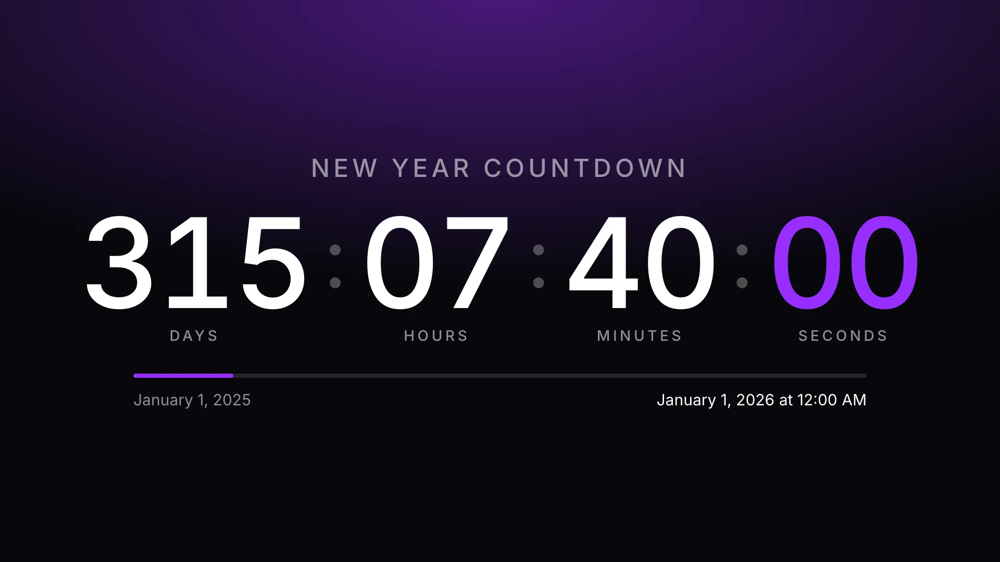

[](https://github.com/Screenly/countdown-timer-app/releases/latest)

# Screenly Countdown Timer App



Counts down the days, hours, minutes and seconds to a target date, with a progress bar from the start date to the target. When the countdown reaches zero, the end message replaces the digits.

## Getting Started

```bash
bun install
```

## Deployment

Create and deploy the Edge App:

```bash
screenly edge-app create --name my-countdown-timer --in-place
bun run deploy
screenly edge-app instance create
```

### Releasing

Pushes to `main` start a stage deploy, which waits for approval. To release to production, tag a commit on `main` and push the tag (the workflow refuses tags not on `main`); the production deploy also waits for approval:

```bash
git checkout main && git pull
git tag v26.10.0
git push origin v26.10.0
```

Then publish a GitHub Release whose notes list the pull requests merged since the previous release. Add `--draft` to review the notes before publishing:

```bash
gh release create v26.10.0 --verify-tag --generate-notes --title v26.10.0
```

## Configuration

The app accepts the following settings via `screenly.yml`:

| Setting              | Description                                                                                                                                             | Type               | Default               |
| -------------------- | ------------------------------------------------------------------------------------------------------------------------------------------------------- | ------------------ | --------------------- |
| `countdown_headline` | Headline displayed above the countdown                                                                                                                  | required           | `New Year Countdown`  |
| `target_timestamp`   | When the countdown ends (`YYYY-MM-DDTHH:MM:SS`), read as local time in the screen's timezone. Add an offset (e.g. `Z` or `+02:00`) to pin it explicitly | required           | `2028-01-01T00:00:00` |
| `starting_timestamp` | When the countdown begins (`YYYY-MM-DDTHH:MM:SS`), used for the progress bar. The bar is hidden if this is not before the target                        | required           | `2025-01-01T00:00:00` |
| `countdown_end_text` | Message displayed when the countdown reaches zero                                                                                                       | required           | `Countdown Finished!` |
| `override_locale`    | Override the locale used for unit labels and dates (e.g. `en`, `fr`, `de`)                                                                              | optional, advanced | `en`                  |
| `override_timezone`  | Override the timezone (e.g. `Europe/London`, `America/New_York`). Defaults to the screen's timezone if left blank                                       | optional, advanced | -                     |
| `display_errors`     | Display detailed error messages on screen for debugging purposes                                                                                        | optional, advanced | `false`               |

The accent color follows the screen's brand settings.

## Development

```bash
bun install      # Install dependencies
bun run dev      # Start development server
```

## Testing

```bash
bun test
```

## Screenshots

Generate screenshots at all supported resolutions:

```bash
bun run screenshots
```

Screenshots are saved to the `screenshots/` directory.
